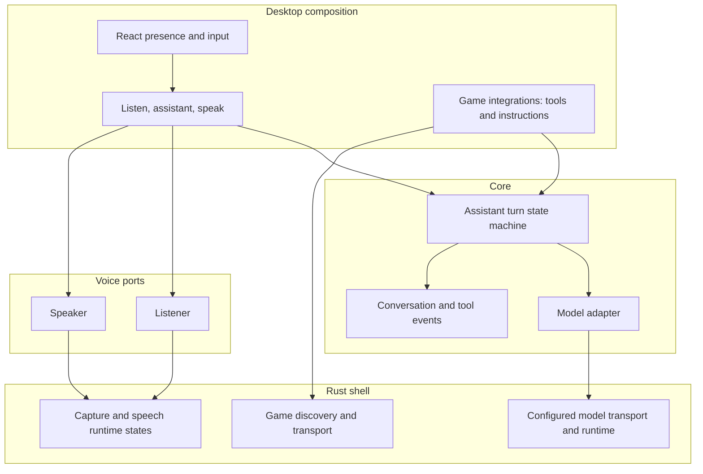

# Architecture

Caprice separates four responsibilities: the assistant turn, model adapters, runtime management, and game integrations. TypeScript owns conversation and tool execution. Rust owns the desktop, microphone, child processes, credentials, and privileged transport.

`packages/core` imports neither voice nor desktop. `packages/voice` imports neither core nor desktop. Desktop is the composition root. React observes the application and binds input; it does not construct provider requests or implement game behavior.

## Assistant

A turn retains the original user request separately from model output and tool results. Events distinguish `user`, `assistant`, `tool-call`, and `tool-result`. Tools carry their name, description, read/action classification, input parser, and implementation. The model-facing registry comes from the tools actually offered. Instructions live in skills; core receives their text and does not open files.

The host request authorizes the actions needed for it. "Pick Yasuo" permits lookup and selection without a second confirmation. Tool data is not a new user request. Input validation and transport restrictions remain enforced by code; a prompt is not a substitute for those boundaries.

The assistant executes at most four tools before asking for a final answer without tools. Invalid or failed calls are reported to the model as tool errors. Cancellation stops subsequent steps and suppresses late responses; it cannot undo an action already accepted by a game API. Conversation trimming must retain valid call/result exchanges. Persistence keeps bounded user and assistant messages, not raw game payloads.

## Adapters and runtimes

A model adapter translates between core events and a provider protocol. The current chat adapter supports the text-call convention and native function calls. A different provider protocol belongs in another adapter. Changing model weights behind the same protocol is configuration.

The runtime layer manages process ownership, readiness, deadlines, cancellation, and shutdown. An external brain endpoint does not belong to Caprice; a managed child does. Stopping Caprice must not terminate an externally owned service. STT and Woof are resident children, independent of the assistant loop. Provider failures reset only the affected runtime.

Rust obtains the brain endpoint and credentials from configuration. The page sends a body and request identifier, not a destination or secret. Request identifiers keep cancellation of an old model call from aborting a newer call.

## Voice

Push-to-talk progresses through arming, recording, finishing, and the reply. Microphone ownership remains in Rust until the utterance is finished or cancelled. Streaming engines receive incremental resampled audio while held; whole-clip engines transcribe after release. No incomplete transcript is used to execute actions after a recording or feed failure.

The page plays returned audio. Escape cancels capture, the assistant turn, synthesis, and playback. Cancelling playback also prevents a pending synthesis result from starting later. The `hear`, `reply`, and `voice` times separate transcription after release, model/tool work, and synthesis before playback.

The frameless window opens at the top left of the work area. Hold Alt+Space, Ctrl+Space, or the box to speak. Dragging moves it; a tap does not send. Shortcuts are local to the window.

## Games

An integration owns its tools and game instructions. Application composition selects integrations; core has no League dependency. Rust's League facade delegates credential discovery, request parsing, and HTTP exchange to separate modules. Blocking process discovery runs off the async executor. Credentials remain in Rust, requests stay on loopback, redirects and retries are disabled, and response reads are bounded.

Live commentary is a desktop poll of that same live-client read. One new fact becomes a host line. The reply is spoken with tools refused, and it is not written into the saved thread. A host turn cancels it.
