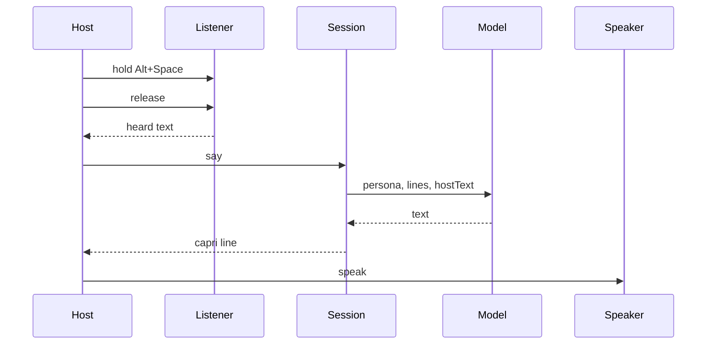

# Architecture

Caprice is a desktop companion. The shell is Tauri. The session, the model, and tools are TypeScript. Voice is a pair of ports. The window fills them from the webview's Web Speech API.

`packages/core` imports neither `packages/voice` nor `packages/desktop`. `packages/voice` imports nothing from the other packages. `packages/desktop` is the only place that composes them. Skills are markdown the model reads. Core does not open files. The shell passes the skill text in.

Hold Alt+Space while the window is focused, or hold the button, and release. `listenAndSay` passes the heard text to `say`. `sayAndSpeak` speaks the capri line. The chord is `talkChord` in `packages/desktop/src/talk.ts`. It is a window shortcut, not a global one. The listener is `speechListener` over `SpeechRecognition` or `webkitSpeechRecognition`. The speaker is `browserSpeaker` over `speechSynthesis`. Neither path names a microphone, a sample rate, or a speech model server. `scriptedListener` and `recordingSpeaker` stay for tests. Listening needs microphone permission where the webview has recognition. WebKitGTK 2.52 on Linux leaves recognition and synthesis undefined, and the window says so. A window manager can take Alt+Space before the page sees it. The button still starts a listen. The chat model is unchanged: the window calls `chatModel`. `persona` is the system message. Each line becomes a user or assistant message. `hostText` is sent only when it is not already the last host line. `CAPRICE_MODEL_URL` is the full chat URL. `CAPRICE_MODEL` is the model name in the body. Neither has a default in the source. Inside the Tauri window those values come from the process environment, and Rust posts the request. Outside it, Vite passes the same names through and the page posts. The stub model remains for tests. It ignores the persona and quotes the host. Tools are stored on the session and are not called yet.

Rust opens the window. It does not own the session. Computer tools, when they exist, cross that bridge from a `Tool` in core to a host implementation. One tool, one file, registered by name.
