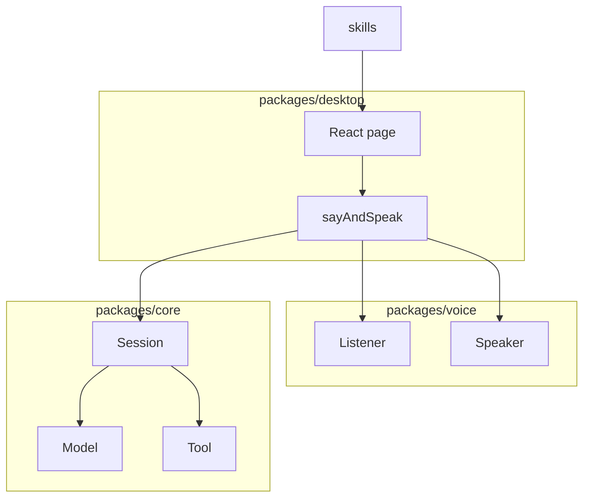
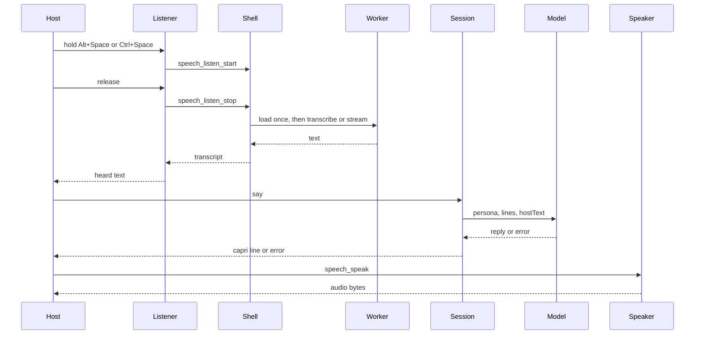

# Architecture

Caprice is a desktop companion. The shell is Tauri. The page is React. The session, the model, and tools are TypeScript. Voice is a pair of ports. The listener is `captureListener`. Inside the Tauri window, Rust records the default microphone and a speech worker transcribes it.

`packages/core` imports neither `packages/voice` nor `packages/desktop`. `packages/voice` imports nothing from the other packages. `packages/desktop` is the only place that composes them. Skills are markdown the model reads. Core does not open files. The shell passes the skill text in.

The page is React. `useSession` opens the session and holds to talk. The window is frameless, transparent, and always on top. It sits at the corner of the work area. The window is the chamfered cyan box. While she works and nothing is playing, the box names the step in progress. `hear` is transcription after release, `reply` is the model, and `voice` is speech synthesis before playback. Those times stay on the box until the next hold. While audio plays, the box shows a sine whose height is the moment being heard. The page does not render the host line or the capri line. The trouble line stays. Hold Alt+Space or Ctrl+Space while the window is focused, or hold the box, and release. A tap does not send. Listening starts after the hold passes `talkHoldDelay`. `listenAndSay` passes the heard text to `say`. `sayAndSpeak` speaks the capri line. The chords are `talkChords` in `packages/desktop/src/talk.ts`. They are window shortcuts, not global ones. Rust commands `speech_listen_start` and `speech_listen_stop` own the hold. The parent keeps a worker state of idle or live. The worker is this binary with `--speech-worker`. `CAPRICE_STT_ENGINE` selects the engine. `onnx` loads the int8 files from `CAPRICE_STT_MODEL`. `bark` loads the safetensors checkpoint from that directory. `parakeet` loads a Parakeet Unified English 0.6B GGUF and the parent feeds samples while the hold is open. Each engine loads once and stays until the window exits. A new model is a new variant. Spoken replies call `speech_speak`. `CAPRICE_TTS_ENGINE` selects the reply. Empty or `http` posts to `CAPRICE_TTS_URL` with `CAPRICE_TTS_MODEL`. Optional `CAPRICE_TTS_VOICE` and `CAPRICE_TTS_API_KEY`. `woof` is a resident child. `CAPRICE_PYTHON` is that interpreter when it is set. Empty uses `python3`. The page plays the bytes either way. `speech_credit` is `Voice by Underdog Woof` when that child is selected. Outside the window the page does not invoke. Listening fails, and speaking posts only when `CAPRICE_TTS_URL` and `CAPRICE_TTS_MODEL` are set. `scriptedListener` and `recordingSpeaker` stay for tests. No microphone name, host, or model path is hardcoded. Caprice does not start Handy and does not use the Web Speech API. WebKitGTK does not matter for speech. A window manager can still steal Alt+Space. Ctrl+Space still works. The button still works. The window calls `chatModel`. `persona` is the system message. Each line becomes a user or assistant message. The page stores the last 20 lines in `localStorage` under `caprice.thread` and passes them back in when the window opens again, so the first reply still has the last conversation. Those lines are not drawn. `hostText` is sent only when it is not already the last host line. `CAPRICE_MODEL_URL` is the full chat URL. `CAPRICE_MODEL` is the model name in the body. Neither has a default in the source. Inside the Tauri window those values come from the process environment, and Rust posts the request. Outside it, Vite passes the same names through and `postJson` posts. `tryCatch` turns a rejected request into a `Result`. The page checks `ok` before it reads `value`. A failed reply leaves the host line in the session, and the page shows `error.message`. The stub model remains for tests. It ignores the persona and quotes the host. Tools are stored on the session and are not called yet.

Rust opens the window. It does not own the session. Computer tools, when they exist, cross that bridge from a `Tool` in core to a host implementation. One tool, one file, registered by name.
