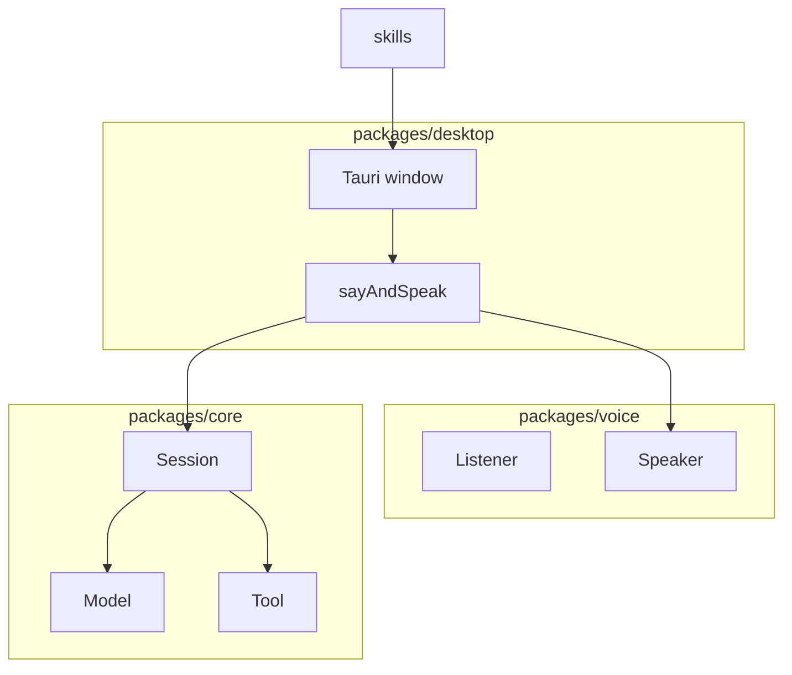
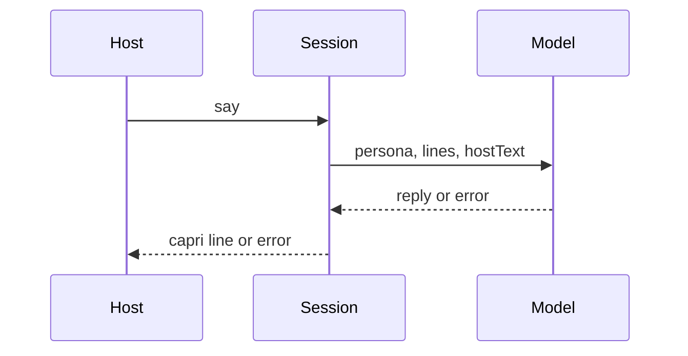

# Architecture

Caprice is a desktop companion. The shell is Tauri. The session, the model, and tools are TypeScript. Voice is a pair of ports with no devices yet.

`packages/core` imports neither `packages/voice` nor `packages/desktop`. `packages/voice` imports nothing from the other packages. `packages/desktop` is the only place that composes them. Skills are markdown the model reads. Core does not open files. The shell passes the skill text in.

The listener is not wired. The next voice milestone connects `listen` to `say`. The speaker is wired: `sayAndSpeak` speaks the capri line. The window calls `chatModel`. `persona` is the system message. Each line becomes a user or assistant message. `hostText` is sent only when it is not already the last host line. `CAPRICE_MODEL_URL` is the full chat URL. `CAPRICE_MODEL` is the model name in the body. Neither has a default in the source. Inside the Tauri window those values come from the process environment, and Rust posts the request. Outside it, Vite passes the same names through and `postJson` posts. `tryCatch` turns a rejected request into a `Result`. The page checks `ok` before it reads `value`. A failed reply leaves the host line in the session, and the page shows `error.message`. The stub model remains for tests. It ignores the persona and quotes the host. Tools are stored on the session and are not called yet.

Rust opens the window. It does not own the session. Computer tools, when they exist, cross that bridge from a `Tool` in core to a host implementation. One tool, one file, registered by name.
