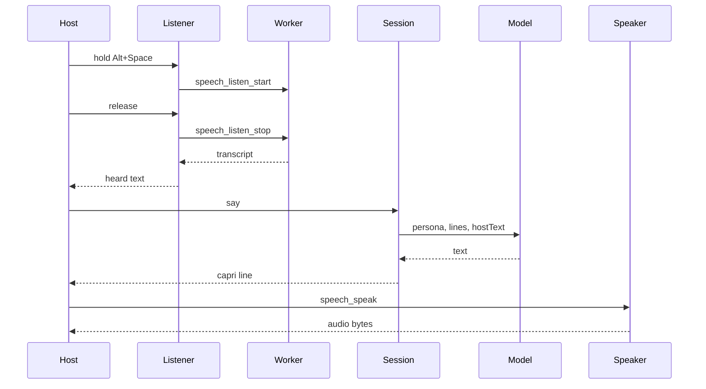

# Architecture

Caprice is a desktop companion. The shell is Tauri. The session, the model, and tools are TypeScript. Voice is a pair of ports. The listener is `captureListener`. Inside the Tauri window, Rust records the default microphone and a resident worker transcribes a wav path.

`packages/core` imports neither `packages/voice` nor `packages/desktop`. `packages/voice` imports nothing from the other packages. `packages/desktop` is the only place that composes them. Skills are markdown the model reads. Core does not open files. The shell passes the skill text in.

Hold Alt+Space while the window is focused, or hold the button, and release. `listenAndSay` passes the heard text to `say`. `sayAndSpeak` speaks the capri line. The chord is `talkChord` in `packages/desktop/src/talk.ts`. It is a window shortcut, not a global one. The listener is `captureListener`. Rust commands `speech_listen_start` and `speech_listen_stop` own the hold. The worker is a Python process. Protocol is JSON lines on stdin/stdout. It loads once and stays up until the window process exits. `CAPRICE_STT_WORKER` is the script path. `CAPRICE_STT_PYTHON` overrides the interpreter (default `python3` in the shell). `CAPRICE_STT_MODEL` is required by that script. `CAPRICE_STT_DEVICE` is `auto`, `cpu`, or `cuda` (auto in the script when unset). GPU uses float16 and CPU uses int8 unless `CAPRICE_STT_COMPUTE` is set. `CAPRICE_STT_LANGUAGE` is optional. Spoken replies call `speech_speak`. `CAPRICE_TTS_URL` and `CAPRICE_TTS_MODEL` are the endpoint and the model. Optional `CAPRICE_TTS_VOICE` and `CAPRICE_TTS_API_KEY`. Rust posts inside the window. The page plays the bytes. There is no resident TTS model. Outside the window the page does not invoke. Listening fails, and speaking fetches only when `CAPRICE_TTS_URL` and `CAPRICE_TTS_MODEL` are set. `scriptedListener` and `recordingSpeaker` stay for tests. No microphone name, sample rate, host, or model id is hardcoded. Caprice does not shell out to Handy or Parakeet and does not use the Web Speech API. WebKitGTK does not matter for speech. A window manager can still steal Alt+Space. The button still works. The chat model is unchanged: the window calls `chatModel`. `persona` is the system message. Each line becomes a user or assistant message. `hostText` is sent only when it is not already the last host line. `CAPRICE_MODEL_URL` is the full chat URL. `CAPRICE_MODEL` is the model name in the body. Neither has a default in the source. Inside the Tauri window those values come from the process environment, and Rust posts the request. Outside it, Vite passes the same names through and the page posts. The stub model remains for tests. It ignores the persona and quotes the host. Tools are stored on the session and are not called yet.

Rust opens the window. It does not own the session. Computer tools, when they exist, cross that bridge from a `Tool` in core to a host implementation. One tool, one file, registered by name.
